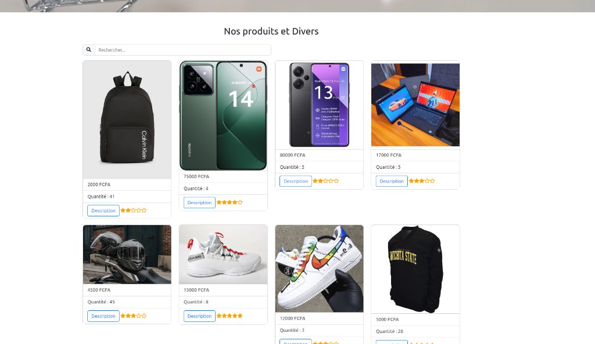
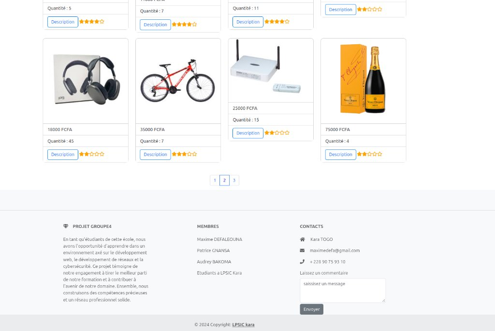
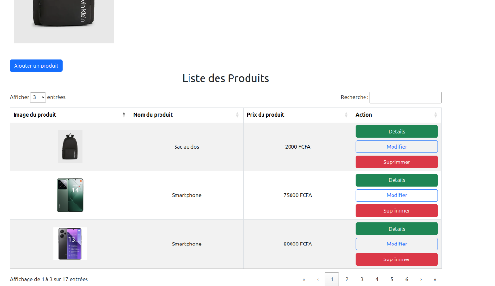
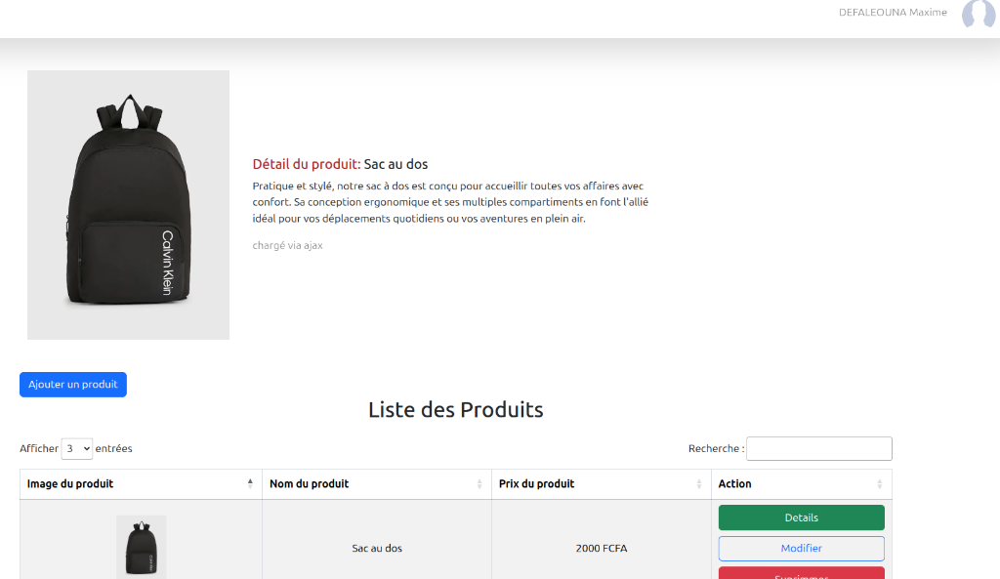
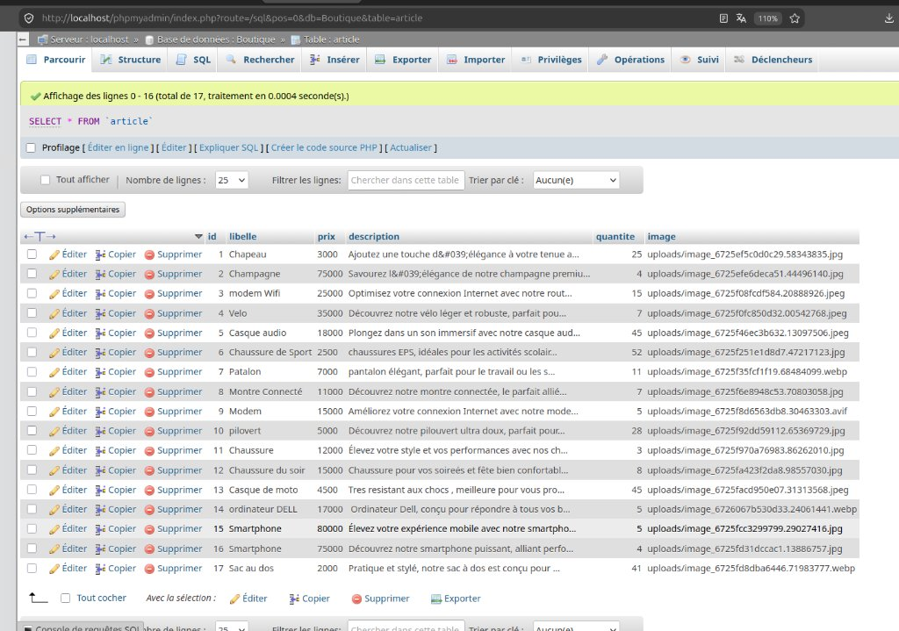

# Boutique en ligne - Plateforme E-Commerce PHP & MySQL

Application web dynamique développée en PHP natif avec PDO et base de données MySQL / MariaDB. Le système intègre une authentification multi-rôles (Administrateur et Utilisateur), un catalogue de produits interactif pour les clients, ainsi qu'un tableau de bord de gestion (CRUD) complet assisté par AJAX et DataTables pour les administrateurs.

---

## Aperçu de l'application

### 1. Vitrine Client et Catalogue Produits
Interface de navigation permettant aux visiteurs et clients inscrits de consulter les articles disponibles, d'effectuer des recherches en temps réel et de visualiser les détails des produits.





---

### 2. Espace Administration et Gestion des Stocks
Panneau d'administration réservé à la gestion des articles. Il intègre la bibliothèque DataTables pour la pagination, le tri dynamique et la recherche instantanée, ainsi que des requêtes asynchrones AJAX pour charger les fiches détaillées sans recharger la page.





---

### 3. Structure de la Base de Données
Gestion relationnelle des utilisateurs et du catalogue d'articles sous MySQL / MariaDB.



---

## Fonctionnalités

### Authentification et Sécurité
- Inscription des utilisateurs avec choix du rôle (User ou Admin).
- Chiffrement et hachage sécurisé des mots de passe avec l'algorithme BCRYPT (`password_hash` et `password_verify`).
- Gestion des sessions PHP pour la protection des routes d'administration et de consultation.
- Requêtes SQL préparées via PDO pour prévenir les injections SQL.
- Assainissement des données entrantes (`htmlspecialchars`, validation des formats d'email).

### Espace Utilisateur (Vitrine)
- Présentation responsive des articles sous forme de cartes avec visuels, descriptions, prix en FCFA et stock disponible.
- Moteur de recherche instantané en JavaScript pour filtrer les produits sans rechargement.
- Système de notation par étoiles et affichage des stocks restants.
- En-tête immersif avec intégration vidéo responsive.

### Espace Administration (CRUD Complet)
- **Création (Create)** : Ajout de nouveaux produits avec nom, description, prix, quantité en stock et téléversement d'image.
- **Lecture (Read)** : Listing paginé et filtrable via DataTables. Chargement à la volée des informations d'un article en AJAX (`ajaxDetails.php`).
- **Mise à jour (Update)** : Modification des informations d'un produit existant et mise à jour des images (`modifierArticle.php`, `Update.php`).
- **Suppression (Delete)** : Suppression directe ou asynchrone d'articles (`ajaxDelete.php`, `delete.php`).
- **Gestion des Médias** : Validation des types MIME autorisés (JPEG, PNG, GIF, WEBP, AVIF) et attribution automatique d'identifiants uniques pour chaque image téléchargée.

---

## Technologies Utilisées

- **Backend** : PHP 8.x (Architecture procédurale, PDO, Sessions).
- **Base de données** : MySQL / MariaDB.
- **Frontend** : HTML5, CSS3, JavaScript (ES6), Bootstrap 5, FontAwesome, Bootstrap Icons.
- **Bibliothèques complémentaires** : jQuery 3.7.1, DataTables.
- **Requêtes asynchrones** : AJAX / XMLHttpRequest / Fetch API.

---

## Installation et Déploiement

### 1. Prérequis
- PHP 8.0 ou version ultérieure avec l'extension `pdo_mysql`.
- Un serveur MySQL ou MariaDB (via XAMPP, LAMP ou installation native).
- Git.

### 2. Cloner le dépôt
```bash
git clone https://github.com/maximedefaleouna/Boutique-PHP.git
cd Boutique-PHP
```

### 3. Configuration de la base de données
1. Démarrez votre serveur MySQL / MariaDB.
2. Créez une base de données nommée `Boutique` :
   ```sql
   CREATE DATABASE Boutique CHARACTER SET utf8mb4 COLLATE utf8mb4_general_ci;
   ```
3. Importez le fichier `Boutique.sql` dans cette base :
   ```bash
   mysql -u root -p Boutique < Boutique.sql
   ```
4. Vérifiez les paramètres de connexion dans `connectbd.php` (hôte, nom de la base, utilisateur et mot de passe).

### 4. Droits d'écriture pour les uploads
Sous Linux, assurez-vous que le dossier `uploads/` dispose des droits d'écriture nécessaires pour l'enregistrement des images :
```bash
chmod -R 777 uploads/
```

### 5. Démarrage de l'application

#### Option A : Avec le serveur de développement PHP (Recommandé)
```bash
php -S localhost:8000
```
Accédez ensuite aux adresses suivantes dans votre navigateur :
- Inscription : `http://localhost:8000/inscription.php`
- Connexion : `http://localhost:8000/connexion.php`
- Catalogue : `http://localhost:8000/user.php`

#### Option B : Avec XAMPP
Copiez ou liez le dossier du projet dans le répertoire `htdocs` de XAMPP, puis démarrez les services Apache et MySQL. Accédez au projet via :
`http://localhost/Boutique-PHP/connexion.php`

---

## Équipe et Crédits

Projet réalisé dans le cadre de la formation LPSIC Kara :
- Maxime DEFALEOUNA
- Patrice GNANSA
- Audrey BAKOMA
